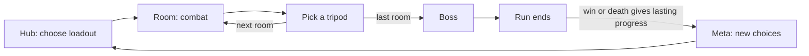

# Core loop

You choose a loadout in the hub, fight room by room and pick a tripod after each room.
The run ends at the boss or at death. Death ends the run. Both give something lasting that opens new choices for the next run.
The build grows inside the run. Meta mostly opens choices, with some raw stats in noticeable, capped steps.
